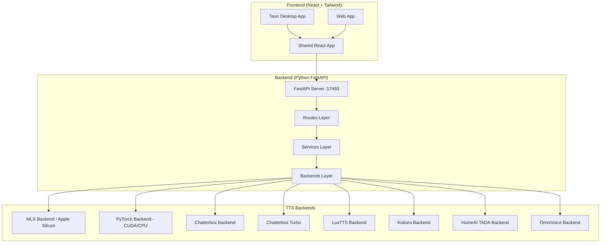

# Voicebox Repository Analysis & Voice Cloning Implementation Plan

## Architecture Overview

## Voice Cloning Engine Comparison

| Engine | Voice Cloning | Languages | VRAM | Quality | Speed | Notes |
|--------|:---:|:-:|:-:|:-:|:-:|---|
| **Qwen3-TTS 1.7B** | ✅ Zero-shot | 10 | ~3.5GB | ⭐⭐⭐⭐⭐ | ⭐⭐⭐ | Best multilingual cloning, delivery instructions |
| **Qwen3-TTS 0.6B** | ✅ Zero-shot | 10 | ~1.2GB | ⭐⭐⭐⭐ | ⭐⭐⭐⭐ | Lighter, still good quality |
| **Chatterbox Multilingual** | ✅ Zero-shot | 23 | ~3.2GB | ⭐⭐⭐⭐ | ⭐⭐⭐ | Broadest language support |
| **Chatterbox Turbo** | ✅ Zero-shot | 1 (EN) | ~1.5GB | ⭐⭐⭐⭐ | ⭐⭐⭐⭐⭐ | Fast, emotion tags |
| **LuxTTS** | ✅ Zero-shot | 1 (EN) | ~300MB | ⭐⭐⭐ | ⭐⭐⭐⭐⭐ | Tiny, CPU-friendly |
| **TADA 1B/3B** | ✅ Zero-shot | 10 | 4-8GB | ⭐⭐⭐⭐⭐ | ⭐⭐ | HumeAI, 700s+ coherent |
| **Kokoro** | ❌ Preset only | 8 | ~350MB | ⭐⭐⭐ | ⭐⭐⭐⭐⭐ | No cloning, preset voices |
| **OmniVoice** | ✅ Zero-shot | 600+ | ~3.3GB | ⭐⭐⭐⭐ | ⭐⭐⭐ | Non-commercial license |

## Recommended Default Engine: **Qwen3-TTS 1.7B**

**Why Qwen3-TTS 1.7B wins for voice cloning:**
1. **Best voice similarity** — purpose-built for zero-shot voice cloning with high fidelity
2. **Natural prosody** — supports delivery instructions ("speak slowly", "whisper")
3. **MLX optimized** — native Apple Silicon acceleration via mlx-audio (4-5x faster than CPU)
4. **10 languages** — covers major world languages
5. **Reasonable VRAM** — 3.5GB is manageable on most machines
6. **Already the default** — Voicebox uses Qwen as its default engine

**Chatterbox is the runner-up** for users who need:
- 23 languages (vs Qwen's 10)
- Emotion/paralinguistic tags (Turbo variant)

## Existing Pipeline (Already Implemented)

The complete voice cloning pipeline already exists:

1. **Upload reference audio** → `POST /profiles/{id}/samples` (supports WAV, MP3, M4A, FLAC, OGG, AAC, WebM, Opus)
2. **Audio preprocessing** → `validate_and_load_reference_audio()` → `preprocess_reference_audio()` (DC offset, trim, peak cap)
3. **Create voice profile** → `POST /profiles` (stores metadata in SQLite)
4. **Voice prompt creation** → `create_voice_prompt_for_profile()` (combines multi-sample audio, creates engine-specific prompt)
5. **Text generation** → `POST /generate` with auto-chunking for long text (`split_text_into_chunks()` + crossfade)
6. **Audio output** → WAV saved to `data/generations/` directory

## Implementation: Focused Voice Cloning Web Interface

Instead of modifying the existing Voicebox frontend (which is a full Tauri desktop app with many features), I'll create a **standalone HTML/CSS/JS web page** that:

- Connects to the Voicebox FastAPI backend (port 17493)
- Provides the streamlined workflow requested
- Leaves all existing Voicebox functionality intact
- Reuses every existing backend endpoint

### Minimum Changes Needed

1. **Zero backend changes** — all APIs already exist
2. **One new file** — `voice_clone.html` in the project root
3. **No build step** — plain HTML/CSS/JS, served by opening in a browser or via the backend

The backend already exposes:
- `GET /health` — hardware detection
- `GET /models` — model status
- `POST /models/{name}/download` — model download with progress
- `POST /profiles` — create voice profile
- `POST /profiles/{id}/samples` — upload reference audio
- `POST /generate` — TTS generation
- `GET /generate/{id}/status` — SSE generation progress
- `GET /audio/{path}` — serve generated audio
- `GET /profiles` — list profiles
